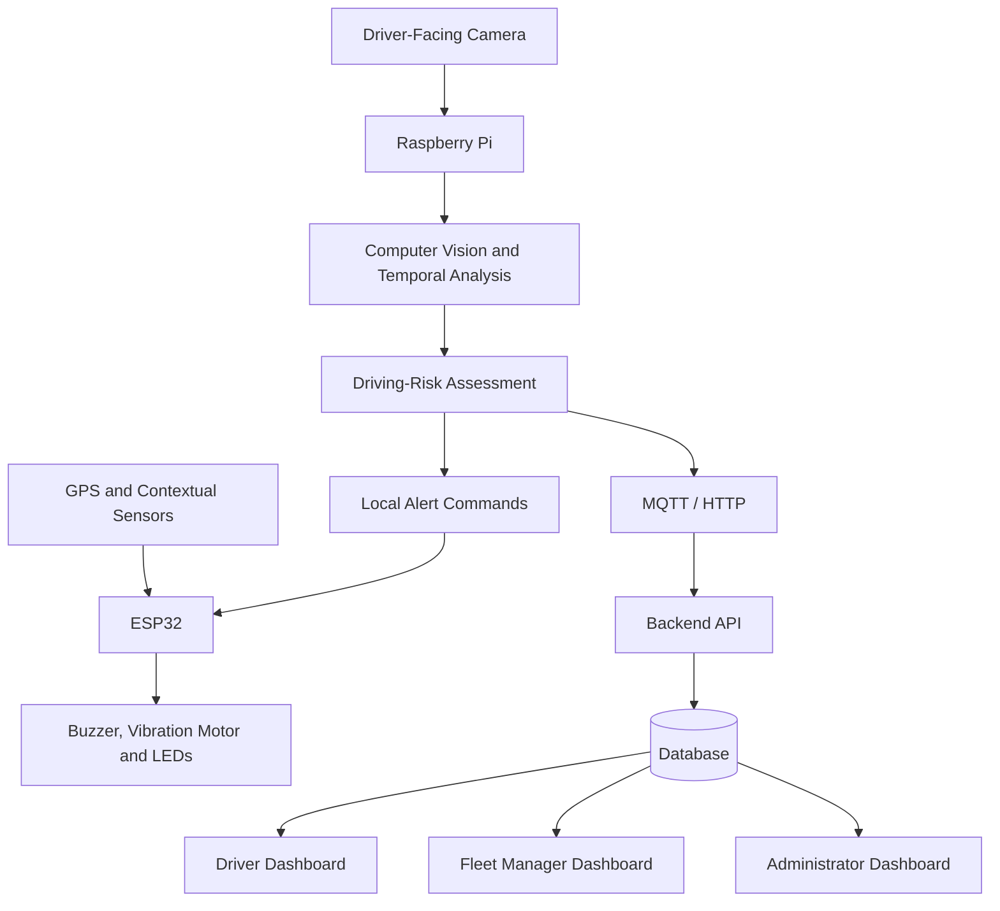

# Edge-AI Driver Vigilance and Risk Monitoring System with Fleet Supervision

**Group 21 – Team Invictus**

## Introduction

Driver drowsiness and distraction are important road-safety concerns, particularly during long-distance journeys and repetitive driving. Drivers experiencing reduced vigilance may show prolonged eye closure, head drooping, or sustained attention away from the road. Fleet operators may also lack an affordable way to review safety events across multiple vehicles.

This project proposes a low-cost, retrofit driver-vigilance and risk-monitoring system that combines Edge AI, embedded systems, and a web-based fleet-supervision platform. A driver-facing camera provides visual input to a Raspberry Pi, which processes frames locally to identify potential drowsiness and distraction. An ESP32 interfaces with contextual sensors and controls local warning devices such as a buzzer, vibration motor, and LEDs.

The system also uses contextual information, including GPS-derived speed, to support explainable driving-risk levels. A secure multi-user web application is planned for drivers, fleet managers, and administrators. Video is processed locally rather than continuously uploaded, and local detection and alerts are designed to continue during Internet outages.

## Key Features

- **Edge-AI monitoring:** Local computer-vision processing on a Raspberry Pi.
- **Drowsiness detection:** Analysis of prolonged eye closure and head drooping.
- **Distraction detection:** Identification of sustained looking-away behaviour.
- **Immediate local alerts:** Buzzer, vibration motor, and warning LEDs controlled by an ESP32.
- **Contextual risk assessment:** Combines driver-state indicators with contextual information such as GPS-derived speed.
- **Fleet supervision:** Planned monitoring of multiple drivers, vehicles, trips, and safety events.
- **Role-based web application:** Separate access for drivers, fleet managers, and administrators.
- **Offline resilience:** Local detection and alerts continue without Internet access; queued events can be synchronized after reconnection.
- **Privacy-conscious design:** Facial video is processed locally rather than continuously uploaded.

## System Architecture

### Main Components

- **Raspberry Pi:** Runs the local computer-vision pipeline, temporal analysis, and risk-assessment engine.
- **Driver-facing camera:** Captures visual information for driver-vigilance analysis.
- **ESP32:** Interfaces with contextual sensors and controls physical warning devices.
- **GPS and other sensors:** Provide contextual readings for risk assessment, subject to hardware availability.
- **Backend and database:** Store users, vehicles, devices, trips, alerts, and device-health records.
- **Web application:** Provides role-based dashboards for drivers, fleet managers, and administrators.
- **Communication:** MQTT or HTTP is planned for event and device-health messages.

## User Roles

| Role | Main Functions |
|---|---|
| Driver | View driving status, receive alerts, review previous trips, and check assigned vehicle and device status |
| Fleet Manager | Supervise multiple drivers and vehicles, review trips and safety events, identify potential speed violations, and view summary reports |
| Administrator | Manage user accounts, permissions, driver and vehicle records, devices, and system logs |

## Hardware and Software

### Planned Hardware

| Component | Purpose |
|---|---|
| Raspberry Pi | Edge computing and local computer vision |
| Driver-facing camera | Driver-state observation |
| ESP32 development board | Sensor interfacing and alert control |
| GPS module | Vehicle-speed estimation when available |
| Buzzer | Audible warning |
| Vibration motor | Physical alert |
| LEDs | Visual status and warning indication |
| Power supply, wiring, and enclosure | Prototype integration |

The final component list may change based on availability, feasibility, and the approved budget.

### Planned Software

- **Edge processing:** Python and suitable computer-vision libraries.
- **Embedded firmware:** ESP32 firmware for sensors, alerts, and device status.
- **Communication:** MQTT or HTTP.
- **Backend and database:** To be finalized during implementation.
- **Web application:** Role-based interfaces for drivers, fleet managers, and administrators.
- **Operating system:** Raspberry Pi OS/Linux on the Raspberry Pi.

The exact libraries, backend framework, database, and frontend stack will be documented once finalized.

## Testing and Evaluation

The project will evaluate detection quality, alert responsiveness, and reliability. Planned tests include:

- Normal blinking compared with prolonged eye closure.
- Head drooping and sustained looking-away behaviour.
- Different users and lighting conditions.
- False warnings and missed events.
- Configured speed-threshold tests.
- Buzzer, vibration motor, and LED response.
- Edge inference performance on the Raspberry Pi.
- Network disconnection and event synchronization after reconnection.
- Role-based access restrictions and device-health reporting.

### Evaluation Metrics

| Metric | Purpose |
|---|---|
| Precision and recall | Measure detection quality |
| False-alarm rate | Measure unnecessary warnings |
| Missed-event rate | Measure undetected risk events |
| Alert latency | Measure time from detection to warning |
| Inference performance | Measure edge-device processing performance |
| Network recovery | Check synchronization after an outage |
| Access-control tests | Verify role separation |

Results will be added after implementation and testing. No performance results are claimed in advance.

## Budget

The preliminary hardware target is approximately **LKR 30,000**, assuming a Raspberry Pi can be borrowed. Final costs depend on component availability and hardware already accessible to the team.

| Item | Quantity | Unit Cost | Total |
|---|---:|---:|---:|
| Raspberry Pi | 1 | Borrowed | 0 LKR |
| Driver-facing camera | 1 | To be confirmed | To be confirmed |
| ESP32 development board | 1 | To be confirmed | To be confirmed |
| GPS module | 1 | To be confirmed | To be confirmed |
| Buzzer, vibration motor, and LEDs | 1 set | To be confirmed | To be confirmed |
| Contextual sensors and wiring | 1 set | To be confirmed | To be confirmed |
| Power supply and enclosure | 1 set | To be confirmed | To be confirmed |
| **Preliminary target** | | | **30,000 LKR** |

This is a preliminary budget target, not a final cost breakdown. Replace estimates with actual quotations and quantities once confirmed.

## Conclusion

This project aims to develop an affordable Edge-AI driver-vigilance and fleet-supervision prototype. By combining local computer vision, embedded alerts, contextual risk assessment, and a multi-user web application, the system is intended to help drivers respond to potential safety risks and enable fleet managers to review events across multiple vehicles.

Expected deliverables include a working hardware prototype, local warning mechanism, backend and database, role-based dashboards, and an experimental evaluation report. Future improvements may include more robust detection under challenging lighting conditions, optimized edge inference, expanded fleet analytics, and pilot testing with transport operators.

The system is intended as a driver-assistance and fleet-supervision solution and will not directly control the vehicle.

## Links

- [Project Repository](https://github.com/cepdnaclk/e22-3yp-RoadEye)
- [Project Page](https://cepdnaclk.github.io/e22-3yp-RoadEye/)
- [Department of Computer Engineering](http://www.ce.pdn.ac.lk/)
- [University of Peradeniya](https://eng.pdn.ac.lk/)

---

*Developed by Group 21 – Team Invictus as an Embedded Systems project at the University of Peradeniya.*
