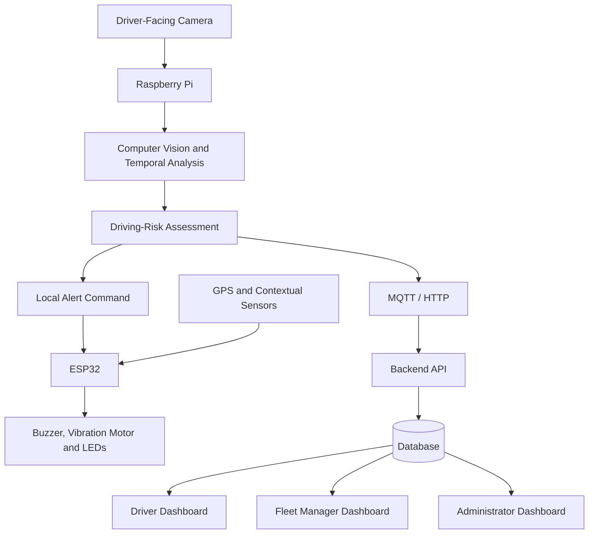

# Edge-AI Driver Vigilance and Risk Monitoring System with Fleet Supervision

**Group 21 – Team Invictus**

## Team

| E-Number | Name | Email |
|---|---|---|
| E/22/336 | Dileka Sadaruwan | [e22336@eng.pdn.ac.lk](mailto:e22336@eng.pdn.ac.lk) |
| E/22/396 | Pahan Prabash | [e22396@eng.pdn.ac.lk](mailto:e22396@eng.pdn.ac.lk) |
| E/22/188 | Dhanushka Kavindaya | [e22188@eng.pdn.ac.lk](mailto:e22188@eng.pdn.ac.lk) |
| E/22/372 | Imasha Sewmini | [e22372@eng.pdn.ac.lk](mailto:e22372@eng.pdn.ac.lk) |

## Table of Contents

1. [Introduction](#introduction)
2. [Solution Architecture](#solution-architecture)
3. [Hardware and Software Designs](#hardware-and-software-designs)
4. [Testing](#testing)
5. [Detailed Budget](#detailed-budget)
6. [Conclusion](#conclusion)
7. [Links](#links)

## Introduction

Driver drowsiness and distraction are important road-safety concerns, particularly during long-distance journeys and repetitive driving. Reduced vigilance may be associated with prolonged eye closure, head drooping, or sustained attention away from the road. Fleet operators may also lack an affordable way to review safety events across multiple vehicles.

This project proposes a low-cost, retrofit driver-vigilance and risk-monitoring system combining Edge AI, embedded systems, and a web-based fleet-supervision platform. A driver-facing camera provides visual input to a Raspberry Pi, which processes frames locally to identify potential drowsiness and distraction. An ESP32 interfaces with contextual sensors and controls local warning devices such as a buzzer, vibration motor, and warning LEDs.

Contextual information, including GPS-derived vehicle speed, may contribute to explainable driving-risk levels. A secure multi-user web application is planned for drivers, fleet managers, and administrators. Facial video is intended to be processed locally rather than continuously uploaded, and local detection and alerts are designed to continue during Internet outages.

The system is intended for transport operators, logistics companies, and other organizations operating vehicle fleets. It is a driver-assistance prototype and will not directly control the vehicle.

### Objectives

- Develop a standalone driver-vigilance prototype using Edge AI.
- Detect potential drowsiness and distraction through multi-frame visual analysis.
- Provide local alerts without depending on Internet connectivity.
- Combine driver-state indicators with contextual information for explainable risk assessment.
- Develop a secure, role-based web application for fleet supervision.
- Evaluate detection performance, false alarms, alert latency, edge performance, and offline recovery.

## Solution Architecture

The planned system combines visual monitoring, edge processing, embedded alerts, backend services, and a multi-user fleet-supervision web application.

### High-Level Architecture

### Main Components

- **Raspberry Pi:** Runs the local computer-vision pipeline, temporal analysis, and risk-assessment logic.
- **Driver-facing camera:** Captures visual information for vigilance analysis.
- **ESP32:** Interfaces with sensors and controls physical warning devices.
- **GPS and contextual sensors:** Provide contextual readings when available and feasible.
- **Backend and database:** Store user accounts, vehicles, devices, trips, alerts, and device-health records.
- **Web application:** Provides role-based dashboards for drivers, fleet managers, and administrators.
- **Communication:** MQTT or HTTP will be evaluated for event and device-health messages.

The local detection-and-alert process is designed to continue during Internet outages. Events can be queued locally and synchronized when connectivity returns.

## Hardware and Software Designs

### Planned Hardware

| Component | Purpose |
|---|---|
| Raspberry Pi | Edge computing and local computer vision |
| Driver-facing camera | Capturing driver visual information |
| ESP32 development board | Sensor interfacing and alert control |
| GPS module | Estimating vehicle speed when available |
| Buzzer | Audible warning |
| Vibration motor | Physical alert |
| Warning LEDs | Visual status and warning indication |
| Power supply, wiring, and enclosure | Prototype integration |

The final component list may change based on availability, feasibility, and budget.

### Planned Software

- **Edge processing:** Python and suitable computer-vision libraries.
- **Embedded firmware:** ESP32 firmware for sensor input, alert control, and device status.
- **Communication:** MQTT or HTTP, to be finalized.
- **Backend and database:** To be selected and documented during implementation.
- **Web application:** Role-based interfaces for drivers, fleet managers, and administrators.
- **Operating system:** Raspberry Pi OS/Linux on the Raspberry Pi.

### User Roles

| Role | Main Functions |
|---|---|
| Driver | View driving status, receive alerts, review trips, and check assigned vehicle/device status |
| Fleet Manager | Supervise multiple drivers and vehicles, review trips and safety events, identify potential speed violations, and view summary reports |
| Administrator | Manage user accounts, permissions, driver and vehicle records, devices, and system logs |

### Privacy and Security

The design aims to process facial video locally rather than continuously upload it to the server. Authentication, role-based access controls, device authentication, and secure server communication are planned.

## Testing

Testing will evaluate detection quality, alert responsiveness, and system reliability. Add measured results after tests are performed; no performance figures are claimed here.

### Planned Test Scenarios

- Normal blinking compared with prolonged eye closure.
- Head drooping and sustained looking-away behaviour.
- Different users and lighting conditions.
- False warnings and missed events.
- Configured speed-threshold tests.
- Buzzer, vibration motor, and LED response.
- Edge inference performance on the Raspberry Pi.
- Network disconnection and event synchronization after reconnection.
- Role-based access restrictions and device-health reporting.

### Evaluation Metrics

| Metric | Purpose |
|---|---|
| Precision and recall | Measure detection quality |
| False-alarm rate | Measure unnecessary warnings |
| Missed-event rate | Measure undetected risk events |
| Alert latency | Measure time from detection to warning |
| Inference performance | Measure edge-device processing performance |
| Network recovery | Check synchronization after an outage |
| Access-control tests | Verify role separation |

Experiments are planned using suitable public datasets and a smaller, consent-based controlled dataset.

## Detailed Budget

The preliminary hardware target is approximately **LKR 30,000**, assuming a Raspberry Pi can be borrowed. Final costs depend on component availability and hardware already accessible to the team.

| Item | Quantity | Unit Cost | Total |
|---|---:|---:|---:|
| Raspberry Pi | 1 | Borrowed | 0 LKR |
| Driver-facing camera | 1 | To be confirmed | To be confirmed |
| ESP32 development board | 1 | To be confirmed | To be confirmed |
| GPS module | 1 | To be confirmed | To be confirmed |
| Buzzer, vibration motor, and LEDs | 1 set | To be confirmed | To be confirmed |
| Contextual sensors and wiring | 1 set | To be confirmed | To be confirmed |
| Power supply and enclosure | 1 set | To be confirmed | To be confirmed |
| **Preliminary target** | | | **30,000 LKR** |

This is a preliminary target, not a final cost breakdown. Replace estimates with actual quotations and quantities once confirmed.

## Conclusion

This project aims to develop an affordable Edge-AI driver-vigilance and fleet-supervision prototype. By combining local computer vision, embedded alerts, contextual risk assessment, and a multi-user web application, the system is intended to help drivers respond to potential safety risks and enable fleet managers to review events across multiple vehicles.

Expected deliverables include a hardware prototype, local warning mechanism, backend and database, role-based dashboards, and an experimental evaluation report. Future work may include improving detection under challenging lighting conditions, optimizing edge inference, expanding fleet analytics, and pilot testing with transport operators.

## Links

- [Project Repository](https://github.com/cepdnaclk/e22-3yp-RoadEye)
- [Project Page](https://cepdnaclk.github.io/e22-3yp-RoadEye/)
- [Department of Computer Engineering](http://www.ce.pdn.ac.lk/)
- [University of Peradeniya](https://eng.pdn.ac.lk/)

---

*Developed by Group 21 – Team Invictus as an Embedded Systems project at the University of Peradeniya.*
