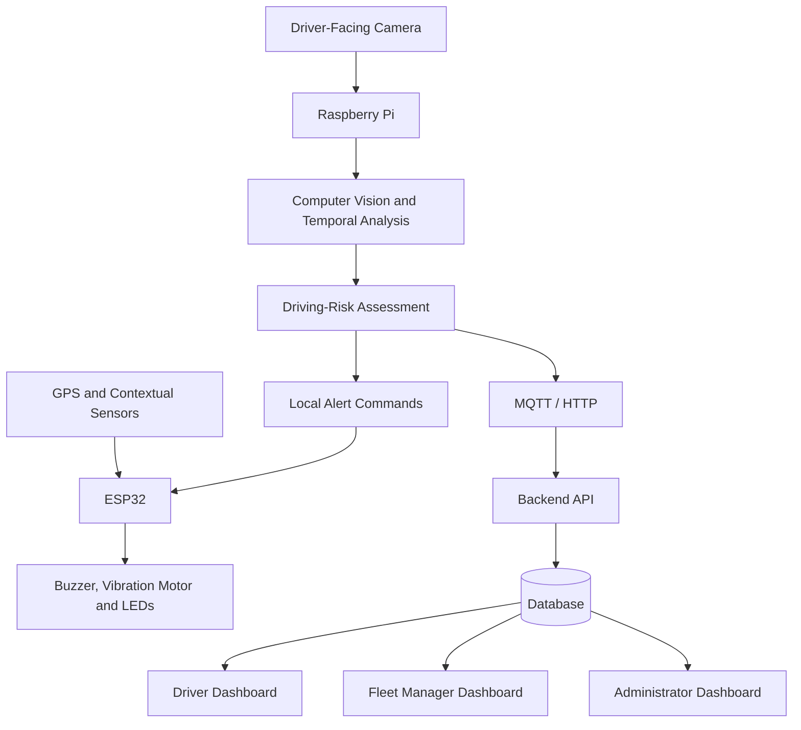

# Vigilix — Edge-AI Driver Vigilance and Risk Monitoring System with Fleet Supervision

**Group 21 – Team Invictus**

---

## Team

Add your team members' details below.

- E/YY/XXX, Team Member Name, [email](mailto:member@eng.pdn.ac.lk)
- E/YY/XXX, Team Member Name, [email](mailto:member@eng.pdn.ac.lk)
- E/YY/XXX, Team Member Name, [email](mailto:member@eng.pdn.ac.lk)

#### Table of Contents

1. [Introduction](#introduction)
2. [Solution Architecture](#solution-architecture)
3. [Hardware and Software Designs](#hardware-and-software-designs)
4. [Testing](#testing)
5. [Detailed Budget](#detailed-budget)
6. [Conclusion](#conclusion)
7. [Links](#links)

## Introduction

Driver drowsiness and distraction are important road-safety concerns, particularly during long-distance journeys and repetitive driving. Drivers experiencing reduced vigilance may show prolonged eye closure, head drooping, or sustained attention away from the road. These behaviours can increase accident risk, while fleet operators may lack an affordable way to monitor safety events across multiple vehicles.

**Vigilix** is a low-cost, retrofit driver-vigilance and risk-monitoring system that combines Edge AI, embedded systems, and a web-based fleet-supervision platform. A driver-facing camera captures visual information, while a Raspberry Pi processes video locally to identify potential drowsiness and distraction. An ESP32 controls physical warning devices, such as a buzzer, vibration motor, and warning LEDs, to alert the driver when a potential risk is detected.

The system also incorporates contextual information, including GPS-derived vehicle speed, to support explainable driving-risk assessment. A secure web application provides separate interfaces for drivers, fleet managers, and administrators to review trips, monitor safety events, supervise vehicles, and manage system records.

Vigilix is intended for transport operators, logistics companies, and other organizations operating vehicle fleets. Facial video is processed locally rather than continuously uploaded, and local detection and alerts are designed to continue during Internet outages.

### Project Objectives

- Develop a standalone driver-vigilance monitoring prototype using Edge AI.
- Detect potential drowsiness and distraction through multi-frame visual analysis.
- Provide immediate local alerts without depending on Internet connectivity.
- Integrate contextual sensor information into an explainable driving-risk assessment.
- Develop a secure, role-based web application for multi-user fleet supervision.
- Evaluate detection performance, false alarms, alert latency, and system reliability.

## Solution Architecture

The system combines visual monitoring, edge processing, embedded alerts, backend services, and a fleet-supervision web application.

### High-Level Architecture

### Main Components

- **Raspberry Pi:** Runs the computer-vision pipeline, temporal analysis, and risk-assessment engine locally.
- **Camera:** Captures driver facial and head-pose information for vigilance analysis.
- **ESP32:** Interfaces with sensors and controls physical warning devices.
- **Contextual sensors:** GPS-derived speed and other feasible sensor readings support risk assessment.
- **Backend and database:** Store user accounts, vehicles, devices, trips, alerts, and device-health records.
- **Web application:** Provides role-based dashboards for drivers, fleet managers, and administrators.
- **Communication:** MQTT or HTTP will be used to transmit events and device-health information.

The local detection-and-alert process is designed to continue during Internet outages. Events can be queued locally and synchronized when connectivity returns.

## Hardware and Software Designs

### Hardware Design

| Component | Purpose |
|---|---|
| Raspberry Pi | Edge computing and local computer vision |
| Driver-facing camera | Capturing driver facial and head-pose information |
| ESP32 development board | Sensor interfacing and alert control |
| GPS module | Estimating vehicle speed when available |
| Buzzer | Audible warnings |
| Vibration motor | Physical driver alerts |
| Warning LEDs | Visual status and risk indication |
| Power supply, wiring, and enclosure | Power management and prototype integration |

Steering-wheel contact sensing and optional sensors may be evaluated during prototyping, depending on feasibility and budget.

### Software Design

**Edge processing**
- Python-based vision pipeline
- Face and eye analysis
- Temporal drowsiness and distraction detection
- Explainable driving-risk assessment
- Local event logging and offline queueing

**Embedded firmware**
- ESP32 sensor integration
- Alert-device control
- Communication with the Raspberry Pi
- Device-status reporting

**Backend and database**
- User authentication and authorization
- Driver, vehicle, and device management
- Trip and safety-event storage
- Device-health monitoring
- Role-based API access

**Web application**
- Driver dashboard
- Fleet-manager dashboard
- Administrator dashboard
- Trip history and safety-event reports
- Vehicle and device-status monitoring

The exact computer-vision libraries, backend framework, database, and frontend stack will be documented once finalized by the team.

### User Roles

| User Role | Main Functions |
|---|---|
| Driver | View current status, receive alerts, review trips, and check assigned vehicle and device status |
| Fleet Manager | Monitor multiple drivers and vehicles, review safety events, identify potential speed violations, and view summary reports |
| Administrator | Manage accounts, permissions, driver and vehicle records, devices, and system logs |

### Privacy and Security

Facial video will be processed locally rather than continuously uploaded to the server. Authentication, role-based access controls, device authentication, and secure server communication will be included in the design.

## Testing

Testing will evaluate the accuracy, responsiveness, and reliability of the proposed system. Results should be added after tests are performed; no performance figures are assumed in advance.

### Planned Test Scenarios

- Normal blinking compared with prolonged eye closure
- Head drooping and sustained looking-away behaviour
- Different users and lighting conditions
- False warnings and missed detections
- Configured speed-limit threshold tests
- Buzzer, vibration motor, and LED response
- Edge inference performance on the Raspberry Pi
- Network disconnection and event synchronization after reconnection
- Role-based access restrictions and unauthorized API requests
- Device-health reporting and service-restart recovery

### Evaluation Metrics

| Metric | Purpose |
|---|---|
| Precision and recall | Evaluate detection quality |
| False-alarm rate | Measure unnecessary warnings |
| Missed-event rate | Identify undetected risk events |
| Alert latency | Measure time from detection to warning |
| Inference performance | Evaluate edge-device processing speed |
| Network recovery | Verify event synchronization after outages |
| Access-control tests | Verify separation between user roles |

Experiments are planned using suitable public datasets and a smaller, consent-based controlled dataset.

## Detailed Budget

The preliminary hardware target is approximately **LKR 30,000**, assuming a Raspberry Pi is borrowed. Final costs will depend on component availability and the hardware already accessible to the team.

| Item | Quantity | Unit Cost | Total |
|---|---:|---:|---:|
| Raspberry Pi | 1 | Borrowed | 0 LKR |
| Driver-facing camera | 1 | To be confirmed | To be confirmed |
| ESP32 development board | 1 | To be confirmed | To be confirmed |
| GPS module | 1 | To be confirmed | To be confirmed |
| Buzzer, vibration motor, and LEDs | 1 set | To be confirmed | To be confirmed |
| Contextual sensors and wiring | 1 set | To be confirmed | To be confirmed |
| Power supply and enclosure | 1 set | To be confirmed | To be confirmed |
| **Estimated target** | | | **30,000 LKR** |

This is a preliminary target, not a final cost breakdown. Replace the estimates with actual component prices and quantities once confirmed.

## Conclusion

Vigilix proposes an affordable Edge-AI solution for driver-vigilance monitoring and fleet supervision. By combining local computer vision, embedded alerts, contextual risk assessment, and a secure multi-user web application, the project aims to help drivers respond to potential safety risks while enabling fleet managers to review events across multiple vehicles.

Expected deliverables include a working hardware prototype, a local warning mechanism, a backend and database, role-based dashboards, and an experimental evaluation report. Future developments may include improved detection under challenging lighting conditions, optimized edge inference, expanded fleet analytics, and pilot testing with transport operators.

The system is intended as a driver-assistance and fleet-supervision solution and will not directly control the vehicle.

## Links

- [Project Repository](https://github.com/cepdnaclk/vigilix)
- [Project Page](https://cepdnaclk.github.io/vigilix/)
- [Department of Computer Engineering](http://www.ce.pdn.ac.lk/)
- [University of Peradeniya](https://eng.pdn.ac.lk/)

**Important:** Update the repository and project-page URLs if your actual GitHub repository name differs from `vigilix`.
